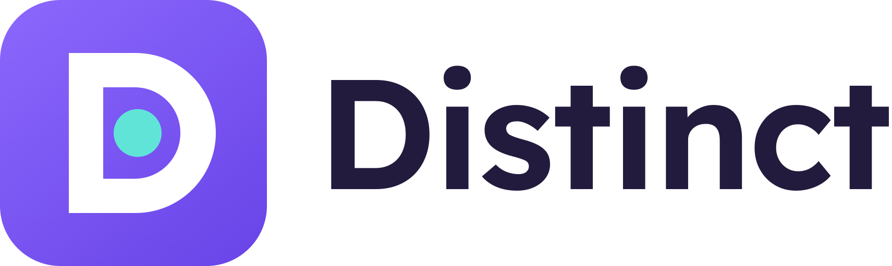

# Distinct



A project made at the Adobe "Marketing Reimagined" hackathon.

https://github.com/user-attachments/assets/a59544fa-9d7f-49d2-8e84-7da656eec44d

The 1-minute demo, with sound. The analysis runs at 3× speed, and the tracking part uses the SIMULATED demo shop. [Download the 1080p version](docs/distinct-demo.mp4).

A Chrome extension for marketers. Open your website and click **Analyze my website**. The extension finds your competitors on its own, reads their pages, compares their messages and design, and gives you three evidence-backed recommendations. You can then track those competitors and turn their changes into tests limited to what you can actually offer.

An analysis takes about 40 seconds and costs about $0.06-$0.08 in AI usage, plus 3 Tavily credits. These figures come from two live runs. The report shows the real cost of each run.

## How it works

```
Chrome extension            Python server (8788)          External services
reads your page     --->    starts a job          --->    Claude: profile, triage, report
follows progress    <---    runs it in background --->    Tavily: finds candidates
shows the report            keeps the result      --->    Playwright: opens competitor pages

Node server (8787): the demo store and proposed tests.
```

If you are new to the project:

- **The extension** holds no keys and does no research. It reads your page and shows the result.
- **A job** is one analysis. The extension gets a job number and asks every 2 seconds how it is going, so closing the panel loses nothing.
- **Claude proposes, the code decides.** A competitor stays only if its URL came from the search and its quote exists on the page we read. A claim stays only if it cites saved evidence.
- **External text is data.** Website content enters prompts inside delimiters, as material to analyze.

## Setup on Windows

You need [Python 3.15](https://www.python.org/downloads/), [Node 24](https://nodejs.org/) and Chrome. Run these in PowerShell from the project folder.

```powershell
npm install
python -m venv .venv
.\.venv\Scripts\python.exe -m pip install -r requirements.txt
.\.venv\Scripts\python.exe -m playwright install chromium-headless-shell
Copy-Item .env.example .env
```

Open `.env` and fill in:

- `ANTHROPIC_API_KEY`, from [platform.claude.com](https://platform.claude.com/)
- `TAVILY_API_KEY`, from [app.tavily.com](https://app.tavily.com/)

Keys live only in `.env`, which Git ignores. Do not put them in `.env.example` or paste them into a chat. If a key ends up in a commit or a message, revoke it and create a new one.

## Running

You need two terminals.

```powershell
# Terminal 1: website analysis
npm run backend

# Terminal 2: demo store and tests
npm start
```

Load the extension:

1. Open `chrome://extensions`.
2. Turn on Developer mode.
3. Click Load unpacked and choose the `extension` folder.

After code changes, restart the servers and click reload on the extension in `chrome://extensions`.

To check the Python server, open `http://localhost:8788/api/health`. `anthropic_configured` and `tavily_configured` should both be `true`.

## Demo script

**Real analysis (1 minute, uses credits):**

1. Open the public site you chose.
2. Click the extension icon, then the round button, and accept the permission for that site.
3. The report opens in a new tab and fills in as it goes. On a wide screen it shows three phones side by side.
4. Show the main opportunity, then open a competitor and an action for the details.
5. Tap a **sources** chip to show the evidence behind a claim.
6. Change the country and tap **Update market** to rerun the search.

**Backup without network or credits (10 seconds):** open `http://localhost:8787/demo/shop` and tap the same round button. On `localhost` the report comes from `backend/fixtures/demo_result.json` and carries the SIMULATED label.

**Tracking over time:**

1. After an analysis, open **Market** and tap the round button to track the selected competitors.
2. Open `http://localhost:8787/demo/control` and click **After**.
3. In **Changes**, tap the round button twice. The second check confirms a change.
4. Open the change and tap **Propose a test**, then **Show on my page** and **Approve**.
5. In **Tests**, open the test to share the brief, the page block or the visual.

The round button always runs the main action of the screen you are on.

**Another site:** open it in the active tab and tap the round button. On Home, the top left button opens the last report. On Market and Changes, the round button tracks and checks while there is something to do.

To show the report offline on any page, set `ANALYSIS_MODE=mock` in `.env` and restart the Python server.

## Appearance

The app always starts in Light. To change it, open the gear icon and choose Light, Dark or System.

## API

| Method | Route | Purpose |
|---|---|---|
| GET | `/api/health` | Server state. Never exposes keys. |
| POST | `/api/analyses` | Starts a job from `page`, or from `rerun_of` with `market_override`. `force: true` skips the saved report. |
| GET | `/api/analyses/{job_id}` | Progress and partial result. `?screenshots=true` includes screenshots. |

Interactive docs are at `http://localhost:8788/docs`.

## Tests

```powershell
npm test
.\.venv\Scripts\python.exe -m pytest backend\tests -q
```

Python tests never reach paid services: Claude and Tavily are faked. `test_fetcher.py` runs real Chromium against local servers.

## Structure

- `extension/`: side panel, report page, page reading, on-page preview.
- `extension/lib/extract-site.js`: reads a site. Used by both the panel and Playwright.
- `extension/lib/rules.js`: rules for tracking, with no AI.
- `backend/app/`: one module per stage:
  - `profile.py`: business profile.
  - `market.py`: target market.
  - `discovery.py`: search and filtering.
  - `fetcher.py` and `url_safety.py`: opening pages safely.
  - `analysis.py`: the report call, verification and evidence.
  - `recommendations.py`: evidence and capability checks.
  - `pipeline.py`: stage order. `jobs.py`: jobs. `llm.py`: Claude calls and cost tracking.
- `server/`: the Node server, with the demo and tests.
- `test/`, `backend/tests/`: tests.

## Design decisions

- **Python next to Node.** The Node server already worked and holds the demo. The analysis lives apart, so nothing was rewritten for it.
- **Three model calls.** Profile, triage and one report call, all on Claude Sonnet 5.5 at low effort. Each page sends 1,500 characters to the model, while quotes are checked against the full page.
- **The same report is not paid for twice.** The same page, market and offer within 30 minutes reuses the finished report, and tapping the round button again opens it for free.
- **No scores.** Similarity appears as observations with evidence, and relevance as direct, indirect or visual reference.
- **Market never comes from language or domain.** They are weak signals. Without delivery, address, local currency or explicit text, the market shows as **Market unconfirmed**.
- **Redirects are followed by hand.** Chromium does not pass them through Playwright's filter, so each hop is checked before the request.
- **No hidden mode.** If a key is missing or the search fails, you see the error. Fake data appears only on `localhost` or with `ANALYSIS_MODE=mock`, labelled SIMULATED.

## Known limits

- Jobs stay in memory for 30 minutes and a Python server restart loses them. The last finished report stays saved in the extension.
- 3 jobs can run at once, locally only.
- Many large stores refuse automated browsers. They appear as **Blocked**, and the number of competitors can fall below 3.
- Cookie banners are not closed. They can appear in screenshots and affect visual notes.
- We read the opened page, usually the competitor's first page, not the whole site.
- URL checks have two small gaps: a domain that changes DNS between the check and the load, and resources such as images that redirect to a private address. In the second case the request leaves, but the page is rejected. The risk is low while the server is local. Before hosting publicly, run the browser isolated from the internal network.
- Change tracking runs only while Chrome is open and only on request.
- Adobe Express Embed SDK is not integrated. The visual downloads a PNG and opens Adobe Express.

## Troubleshooting

| Message | What to do |
|---|---|
| "The analysis server is not responding" | Run `npm run backend` and leave that terminal open. It takes about 8 seconds to start. |
| "Missing from .env: ..." | Fill in the key in `.env`, not `.env.example`, then restart. |
| "The browser is missing" | Run `python -m playwright install chromium-headless-shell` from `.venv`. |
| `EADDRINUSE` on `npm start` | An old server holds port 8787. Stop it. |
| Settings shows "Tests use SIMULATED answers" with a key set | The Node server started before `.env`. Stop it and run `npm start` again. |
